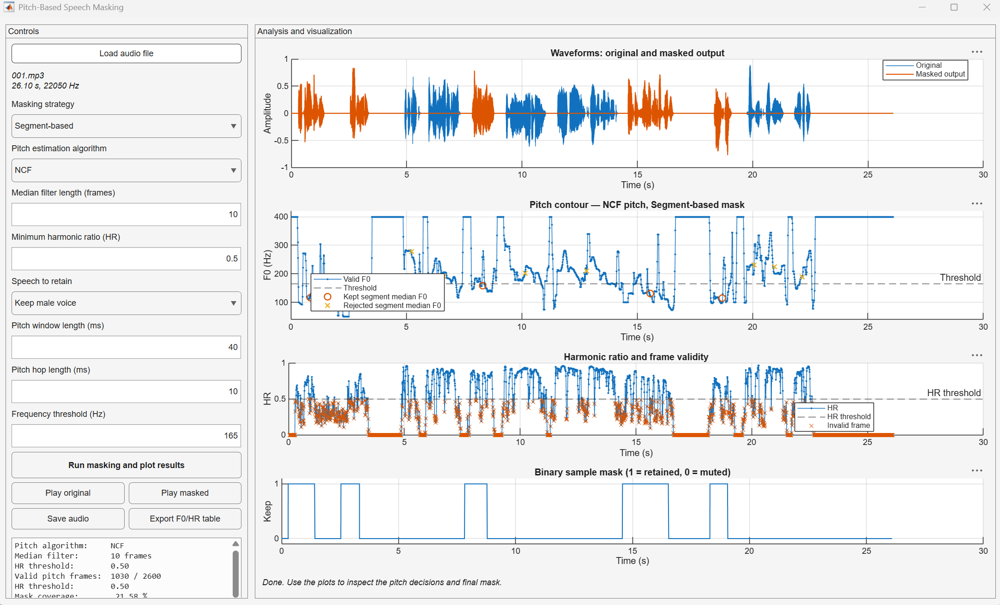
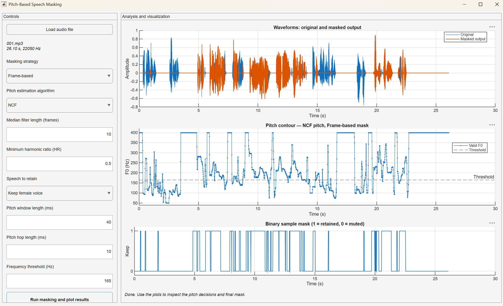
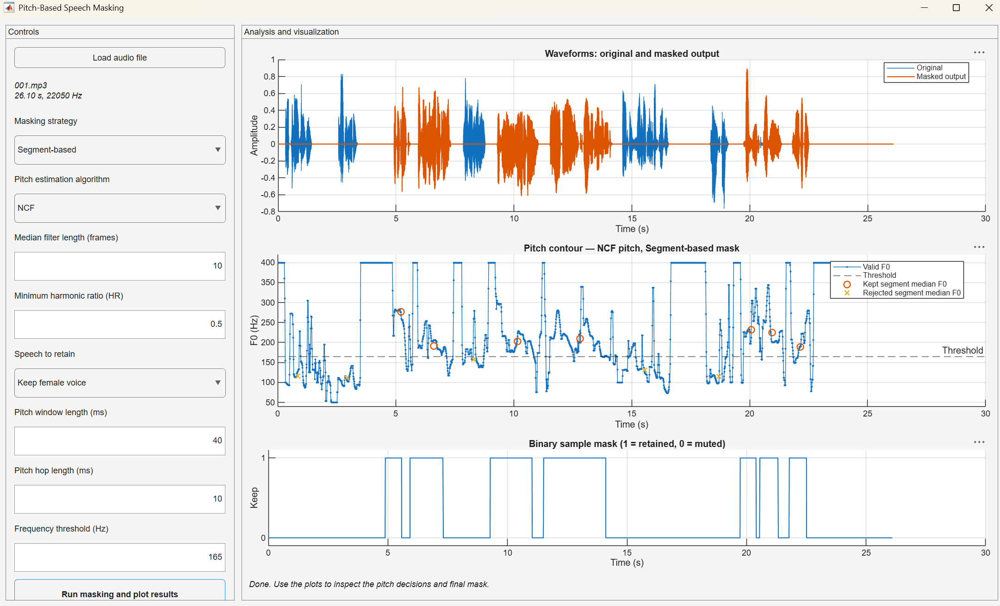

# Pitch-Based Male–Female Speech Filtering

**Frame-Level vs. Segment-Level Masking · MATLAB**

A lightweight, training-free MATLAB project for selectively retaining or muting male-like and female-like speech in **non-overlapping dialogue recordings**. The central experiment compares independent frame-level pitch decisions with speech-segment-level decisions based on **voice activity detection (VAD)** and **median fundamental frequency (F0)**.

> **Scope:** This is pitch-based *speech-turn filtering*, not source separation. It does not recover individual speakers when they talk at the same time, and it does not identify speakers by identity.

## Motivation

Language learners often practice with prerecorded dialogues and manually pause the recording to repeat one speaker's lines. Inspired by A1-level German dialogues in *Themen aktuell 1*, this project explores whether a simple acoustic pipeline can preserve one pitch-defined voice group and suppress the other, without collecting labeled training data.

## Application

The MATLAB GUI supports loading a recording, choosing a masking strategy and voice to retain, adjusting pitch-related parameters, inspecting the original/filtered waveforms and F0 contour, listening to both recordings, and exporting the processed audio.



## Methods

| Stage | Approach | Purpose |
| --- | --- | --- |
| 1 | Frame-level F0 threshold | Baseline: decide whether to retain each short analysis frame using its F0 estimate. |
| 2 | + Harmonic ratio (HR) | Reject low-harmonicity frames with unreliable F0 estimates. |
| 3 | + Voice activity detection (VAD) | Restrict frame-level decisions to detected speech regions. |
| 4 | Segment-level median F0 | Use VAD to form speech segments, estimate reliable F0 values within each segment, and retain/mute the *whole segment*. |

### Frame-level masking

Audio is divided into overlapping frames. MATLAB's `pitch` function estimates F0 using the **normalized correlation function (NCF)**, and a configurable threshold determines which frames to mask. HR and VAD can be added to limit decisions made on unreliable estimates.

Frame-level masking offers fine temporal resolution, but rapid frame-to-frame changes can fragment speech. Unvoiced consonants such as /k/, /t/, and /s/ lack a stable F0 and may remain even when adjacent vowels are muted.

### Segment-level masking

1. Detect speech intervals with MATLAB `detectSpeech`.
2. Within each interval, estimate F0 and harmonic ratio.
3. Exclude invalid or low-harmonicity F0 estimates.
4. Compute the **median** of the remaining F0 values.
5. Compare that median with a configurable threshold and keep or mute the **entire speech interval**.
6. Smooth mask boundaries to reduce abrupt transitions.

Because the decision applies to the whole interval, unvoiced consonants within that interval inherit its mask, reducing choppy output.

## Visual comparison

The screenshots below are taken from the project presentation and show the same test recording processed with different masking strategies.

| Frame-level | Segment-level |
| --- | --- |
|  |  |

**Qualitative observation:** Segment-level masking produced more continuous speech and reduced the fragmented artifacts heard in the frame-level output. This is an observation from listening and visualization, **not a benchmarked accuracy or speed claim**.

## Experiments

- **Window duration:** Frame-level experiments examined 30, 40, 50, 60, 100, and 200 ms windows with a 10 ms hop to inspect changes in pitch contour and mask behavior.
- **Pitch algorithm:** MATLAB provides NCF, PEF, CEP, LHS, and SRH. NCF was chosen based on its relatively balanced gross pitch error (GPE) in the noise-condition examples discussed in the [MathWorks documentation](https://www.mathworks.com/help/audio/ref/pitch.html). The project also compares its behavior conceptually with Praat's filtered autocorrelation.
- **Threshold sensitivity:** With a 165 Hz segment threshold, one female speech segment with median F0 approximately 161 Hz was retained. Changing the threshold to 155 Hz suppressed all female segments in that **particular test recording**. This illustrates the trade-off from overlapping male/female pitch ranges, rather than a universally optimal threshold.
- **Mask comparison:** Waveforms, F0 tracks, retained/muted regions, and the segment-level decisions were examined using the MATLAB interface.

## Limitations

- Assumes speech turns are largely non-overlapping and VAD intervals are dominated by one speaker.
- Low-pitched female voices and high-pitched male voices may overlap in F0 and be misclassified.
- VAD can miss short consonants near speech boundaries or merge adjacent turns by different speakers.
- A mistaken segment-level decision affects an entire interval, not just a short frame.
- No labeled speaker-level ground truth or runtime benchmark is included in the current public materials.

## Requirements and usage

- MATLAB with **Audio Toolbox** (`pitch`, `detectSpeech`, `harmonicRatio`).
- Your own audio input compatible with `audioread`.

**To run:** Add your MATLAB scripts or GUI source to [`app/`](app/) as described in those folders, open the appropriate file in MATLAB, and select a local audio recording. 

Four test audios were provided.

## Repository layout

```text
pitch-based-speech-filtering/
├── README.md
├── GITHUB_DESCRIPTION.txt
├── app/                  # MATLAB GUI source (add your .m or .mlapp file)
├── src/                  # Core MATLAB masking implementations
├── experiments/          # Comparison and plotting scripts
├── results/              # Project screenshots
├── examples/audio/       # Optional redistribution-cleared audio examples
└── docs/                 # Course report, slides and extended notes (optional)
```

## References

- [MathWorks — `pitch`](https://www.mathworks.com/help/audio/ref/pitch.html)
- [MathWorks — `detectSpeech`](https://www.mathworks.com/help/audio/ref/detectspeech.html)
- [MathWorks — `harmonicRatio`](https://www.mathworks.com/help/audio/ref/harmonicratio.html)
- [Praat — Pitch analysis by filtered autocorrelation](https://praat.org/manual/pitch_analysis_by_filtered_autocorrelation.html)
- Biemans, M. (2000). *Gender variation in voice quality*.
- Park, T. J., et al. (2022). A review of speaker diarization: Recent advances with deep learning. *Computer Speech & Language, 72*, 101317.

## Project status

Course-project prototype. The GUI, comparisons, and qualitative findings are documented; the repository is ready for the author's MATLAB source files and final technical report.
